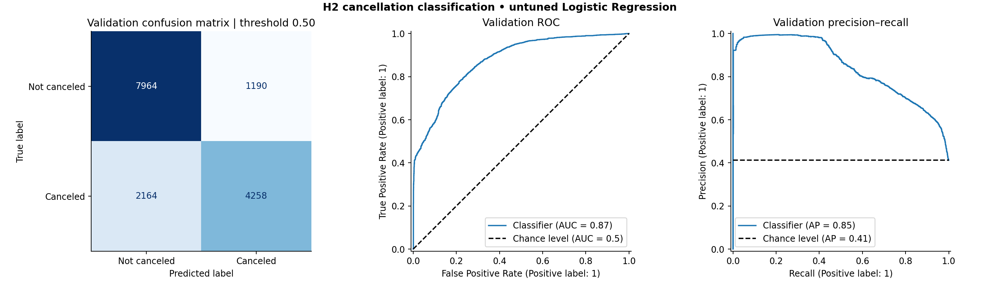

# Milestone 1 — Cancellation classification

Contributor: **Omar Momen Ahmed — 24p0036**. Scope: the team's classification baseline only.
This is an automatically generated experiment report, not the complete team submission.

## Task and prediction point

Predict `IsCanceled` (1 = eventually canceled, 0 = not canceled) when the initial
reservation is recorded. Inputs represent initial reservation details and prior
guest history. H2 is a historical extract, not a versioned booking-time snapshot:
retained reservation details are assumed available at creation and may have been
amended subsequently. This residual timing risk needs team review; these results
are not a claim of production performance.

## Dataset and reproducible split

- Source: `data/H2.csv`, 79,330 rows, 31 columns.
- SHA-256: `5107090ffdc5585a9e18299801e9d85c3b459c235542882183a502a73ef63c4d`.
- Exact duplicate source rows: 25,902.
- Distinct selected-input groups: 50,357.
- Seed: 42. Two GroupShuffleSplit steps reserve 20% of groups for
  the final test, then 25% of remaining groups for validation (about 60/20/20 overall).
- Actual row counts: train **47,871**, validation **15,576**,
  reserved test **15,883**. Group sizes differ, so row percentages need not be exact.
- Cancellation fraction: training 42.24%,
  validation 41.23%.
- Duplicate-looking reservations are retained because separate group bookings can
  legitimately match. Identical normalized input vectors stay in one partition;
  the label is never used to construct these groups. Groups are also respected in CV.
- Three-fold GroupKFold uses **training rows only**. Each fold fits its own complete
  preprocessing pipeline. The model evaluated on validation is fitted only on train.
- The final test is reserved, never passed to model fitting, tuning, prediction,
  evaluation, or result plots. Its membership/count is recorded for Milestone 2.
- This is a random grouped split, not a chronological evaluation. Without customer
  identifiers it cannot guarantee separation of all bookings by the same guest.

## Preprocessing and baseline

21 inputs: 12 numeric and 9 categorical. Numeric gaps use training medians followed
by StandardScaler. Strings are trimmed; NULL/empty markers become missing.
Categorical gaps receive a Missing category; one-hot encoding ignores unseen values.
Agent and Company are categorical IDs, not numeric measurements. No global outlier
clipping, resampling, target encoding, PCA, LDA, or hyperparameter search is performed.
Unusual but valid values are retained for this baseline; train_numeric_summary.csv
supports later review without consulting test data.

Logistic Regression: L2, C=1.0, lbfgs, no class weighting, fixed 0.50 threshold,
max_iter=3000 as a convergence budget. Despite its name, this is a binary classifier.
A prior-probability DummyClassifier is a sanity comparison, not a second learned model family.
The saved pipeline contains normalization, fitted preprocessing and the classifier.
Convergence warnings fail the run rather than silently accepting an unfinished fit.

## Preliminary results — validation only

| Metric | Logistic Regression | Dummy prior | Training CV mean ± sample SD |
|---|---:|---:|---:|
| accuracy | 0.7847 | 0.5877 | 0.7672 ± 0.0058 |
| precision | 0.7816 | 0.0000 | 0.7732 ± 0.0092 |
| recall | 0.6630 | 0.0000 | 0.6357 ± 0.0213 |
| f1 | 0.7174 | 0.0000 | 0.6975 ± 0.0099 |
| roc_auc | 0.8745 | 0.5000 | 0.8568 ± 0.0052 |
| average_precision | 0.8461 | 0.4123 | 0.8322 ± 0.0067 |

Positive class is cancellation. `average_precision` summarizes the precision–recall
curve (AP); it is not the trapezoidal PR area. The dummy uses the training cancellation
fraction for every booking. No model or threshold was selected using these results.

Confusion matrix: rows = actual [0, 1], columns = predicted [0, 1]:
`[[7964, 1190], [2164, 4258]]`.

The model's validation F1 is 0.717 with recall 0.663:
it identifies 66.3% of canceled bookings at the fixed threshold.
Precision 0.782 means 78.2% of its cancellation
alerts are correct on validation. ROC-AUC 0.874 measures ranking,
not the percentage of correct predictions. Compare against the dummy and CV spread;
this preliminary score does not estimate future-time or final-test performance.

## Leakage audit — excluded source columns

| Column | Reason |
|---|---|
| IsCanceled | Target, never an input. |
| ReservationStatus | Final booking outcome directly reveals the target. |
| ReservationStatusDate | Date of a later status update, including cancellation. |
| AssignedRoomType | Actual allocation may be determined after booking. |
| BookingChanges | Cumulative amendments after the reservation was created. |
| DaysInWaitingList | Elapsed waiting time is not known at initial booking. |
| DepositType | Conservative exclusion: collected-deposit status lacks a verified initial snapshot. |
| ADR | Recorded average rate is not a verified initial price quote. |
| RequiredCarParkingSpaces | Conservative exclusion: requests can change after booking. |
| TotalOfSpecialRequests | Conservative exclusion: requests can accumulate after booking. |

Retained features: `LeadTime`, `ArrivalDateYear`, `ArrivalDateWeekNumber`, `ArrivalDateDayOfMonth`, `StaysInWeekendNights`, `StaysInWeekNights`, `Adults`, `Children`, `Babies`, `IsRepeatedGuest`, `PreviousCancellations`, `PreviousBookingsNotCanceled`, `ArrivalDateMonth`, `Meal`, `Country`, `MarketSegment`, `DistributionChannel`, `ReservedRoomType`, `Agent`, `Company`, `CustomerType`.
Calendar and planned-stay fields describe the intended arrival; guest counts, meal,
room and sales-channel fields describe the reservation; repeat-guest and previous-
booking counts describe prior history. The initial-snapshot assumption above applies.
`feature_audit.csv` records a decision for every source column.

## Files, contribution and next milestone

- Implemented classification CLI, train-only preprocessing, duplicate-aware split,
  training CV, validation metrics/plots, schema checks and reusable prediction artifact.
- Experiment outputs are in this directory. `artifacts/classification/` stores the
  model, metadata and split manifest locally and is excluded from Git/submission ZIP.
- Reproduce with `python -m src.classification train` from the repository root.
- Predict without retraining with `python -m src.classification predict --input examples/booking.csv`.
- Milestone 2: compare additional families, tune only inside development data, review
  temporal validation and snapshot availability, assess PCA/LDA appropriately,
  integrate inference in the team application, then evaluate the locked test once.
- Coordinate split policy with regression before the final team submission. This
  change does not certify the other tasks or complete the team's progress report.

## References

- Course project description, Milestone 1 checklist (page 10).
- [Original dataset paper](https://pmc.ncbi.nlm.nih.gov/articles/PMC6297060/).
- [scikit-learn leakage guidance](https://scikit-learn.org/stable/common_pitfalls.html).
- [GroupShuffleSplit](https://scikit-learn.org/stable/modules/generated/sklearn.model_selection.GroupShuffleSplit.html).
